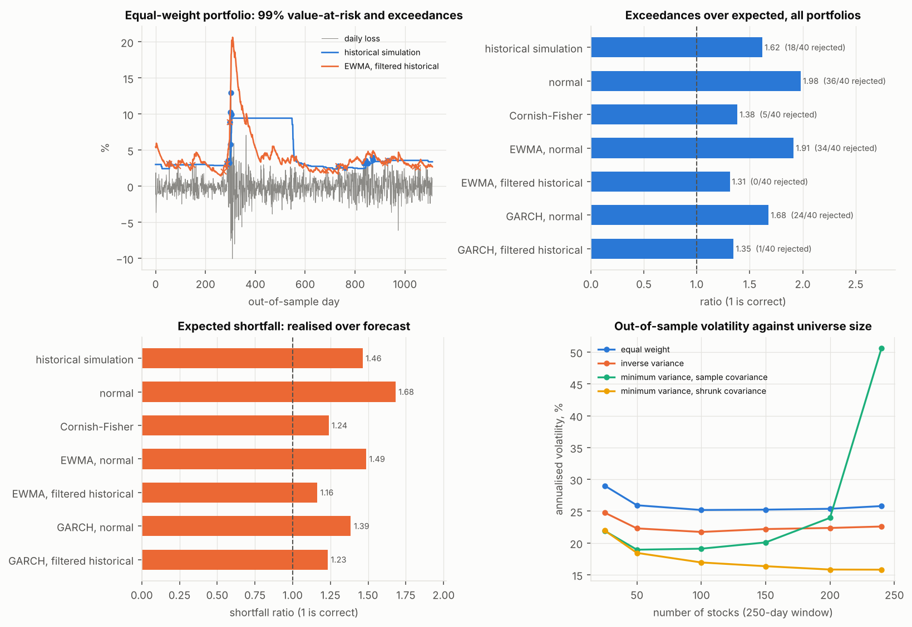

# RiskCore

A market risk engine in C++17 with no dependencies: covariance estimation, one-day value-at-risk and expected shortfall by seven methods, and the statistical backtests that tell good forecasts from bad ones. Tested on five and a half years of daily prices of 300 stocks.

Two questions drive the experiments. Which risk forecast survives a backtest on real data, and why. And what does a better covariance matrix buy when the number of stocks approaches the number of days.

## What is inside

| Area | Files (`cpp/include/riskcore`, `cpp/src`) | Content |
|---|---|---|
| Numerics | `matrix`, `linalg`, `stats`, `normal`, `special`, `rng` | Cholesky, Jacobi eigenvalues, quantiles and tail means, normal and chi-square distributions |
| Data | `csv`, `returns` | price panel reader with validation, portfolio returns |
| Covariance | `covariance`, `portfolio` | sample, exponentially weighted, Ledoit-Wolf shrinkage, minimum-variance weights, Euler risk contributions |
| Volatility | `volatility` | EWMA and GARCH(1,1) by maximum likelihood |
| Risk | `risk` | historical simulation, normal, Cornish-Fisher, EWMA and GARCH with normal tails, EWMA and GARCH filtered historical simulation |
| Backtests | `backtest`, `rolling` | Kupiec frequency test, Christoffersen clustering and joint tests, expected shortfall ratios, rolling drivers |

170 checks in `cpp/tests` run without any framework. Python (`src/riskcore`) unpacks the data, drives the binary and writes the report.

## Results

**Backtest.** 1,111 out-of-sample days, 40 portfolios (all 300 stocks equally weighted, then 39 random portfolios of 20 stocks), 250-day window, 99% value-at-risk and 97.5% expected shortfall.

| Method | Exceedances / expected | Portfolios rejected, frequency | Rejected, clustering | Shortfall ratio |
|---|---|---|---|---|
| Normal | 1.98 | 36 of 40 | 16 | 1.68 |
| EWMA, normal | 1.92 | 34 | 2 | 1.49 |
| GARCH, normal | 1.68 | 24 | 3 | 1.39 |
| Historical simulation | 1.62 | 18 | 21 | 1.46 |
| Cornish-Fisher | 1.38 | 5 | 10 | 1.24 |
| GARCH, filtered historical | 1.35 | 1 | 2 | 1.23 |
| EWMA, filtered historical | 1.31 | 0 | 0 | 1.16 |

The table separates the two ways a forecast fails. A volatility model with normal tails stops the clustering but keeps the wrong frequency. Historical simulation has the right tail shape but reacts a year late, so its exceedances come in clusters. Filtered historical simulation, which rescales the empirical residuals by the current volatility, fixes both and is the only family that the tests do not reject.

**Covariance.** Minimum-variance portfolios from a 250-day window, rebalanced every 21 days, annualised out-of-sample volatility:

| Stocks | Equal weight | Sample covariance | Shrunk covariance | Gross exposure, sample / shrunk |
|---|---|---|---|---|
| 25 | 29.0% | 21.9% | 22.0% | 1.6 / 1.4 |
| 100 | 25.2% | 19.1% | 16.9% | 3.6 / 2.4 |
| 200 | 25.4% | 24.0% | 15.8% | 8.9 / 3.4 |
| 240 | 25.8% | 50.6% | 15.8% | 20.9 / 3.4 |

With 25 stocks the estimator does not matter. With 240 stocks and 250 days the sample covariance produces a portfolio twice as risky as holding everything equally, leveraged 21 times, while the shrunk matrix keeps improving. The shrinkage intensity is only 9 to 10%: a small correction to the matrix, a large one to its inverse.



## Reading the numbers

- Every method, including the best, has more exceedances than expected on this sample (1.31 times for the best). The out-of-sample period contains one market crash, and a 1% quantile read off 250 points is biased towards too little risk. The tests do not reject the filtered methods, which is not the same as showing they are right.
- The 40 portfolios share stocks and dates, so their results are not independent. The rejection counts compare methods on the same portfolios, they are not 40 separate experiments.
- The shortfall ratio mixes frequency and size of exceedances. The separate severity column in the report shows that most of the excess comes from frequency.
- The stocks were selected for having a complete history, which removes failures and makes every risk figure look better than it would have been in real time.
- GARCH parameters are refitted every 21 days with the long-run variance fixed at the sample variance, and innovations are normal in the fit. No Student-t model is included.
- Minimum-variance portfolios allow short positions and ignore transaction costs. The turnover of the sample-covariance portfolio (12 times the capital per rebalance at 240 stocks) would make its real result worse still.
- Shrinkage is towards a multiple of the identity. Other targets may do better on equities and were not tried.
- One-day horizon only, linear positions only.

## Run it

```
pip install -e ".[dev]"
make build      # two binaries in cpp/build: riskcore and riskcore_tests
make test       # C++ checks, then pytest
make run        # writes reports/
```

On your own prices (first column a day counter, then one column per asset):

```
cpp/build/riskcore backtest prices.csv window=250 var_level=0.99 portfolios=1
python scripts/backtest.py prices.csv
python scripts/min_variance.py 150 250 21
```

In C++:

```cpp
#include "riskcore/risk.hpp"
#include "riskcore/volatility.hpp"

rc::Vector path = rc::ewma_variance_path(returns.data(), returns.size(), 0.94);
rc::RiskEstimate e = rc::filtered_historical_risk(returns.data(), returns.size(), 0.99, path);
// e.var and e.es are positive fractions of the portfolio value
```

## Layout

```
cpp/include/riskcore/   headers, one per subject
cpp/src/                implementations and the command line program
cpp/tests/              170 checks with a 30-line harness
src/riskcore/           Python driver, report and figure
data/                   the price panel and its description
configs/                parameters of the experiments
docs/                   methods and formulas
reports/                report, validation table, metrics, figure
```

## Author

Amir Masominia. PhD in physics (Université Paris-Saclay); postdoctoral researcher working on machine-learning surrogate models, numerical simulation and automated measurement pipelines.

MIT licence.
